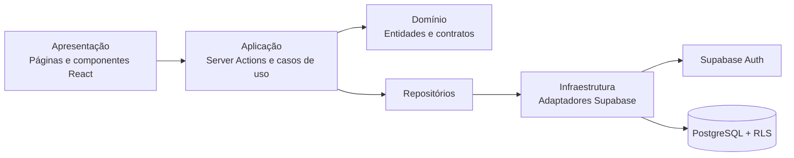

# App Financeiro

Aplicação web responsiva para controle financeiro pessoal. O sistema permite organizar despesas, cartões de crédito, compras parceladas, assinaturas, contas fixas, objetivos financeiros, dashboard e relatórios exportáveis.

A aplicação foi projetada para uso em desktop, tablet, Android e iPhone, com suporte a PWA e cache offline básico de recursos estáticos.

## Visão geral

O App Financeiro centraliza lançamentos em controles financeiros pessoais ou compartilhados. Cada pessoa possui seu próprio login e pode participar de um ou mais controles; os dados de cada controle permanecem isolados por políticas Row Level Security (RLS) no PostgreSQL.

A solução usa Next.js no frontend e Supabase para autenticação e banco de dados. O deploy recomendado é realizado na Vercel, com o código versionado no GitHub.

## Objetivos

- Facilitar o registro e o acompanhamento de despesas pessoais.
- Antecipar gastos futuros de parcelamentos, assinaturas e contas fixas.
- Acompanhar cartões de crédito, limites e ciclos de fatura.
- Dar visibilidade à evolução financeira por meio de indicadores e gráficos.
- Permitir a definição e o monitoramento de objetivos financeiros.
- Disponibilizar relatórios filtráveis e exportáveis.
- Proteger dados financeiros com autenticação e isolamento por usuário.

## Funcionalidades

### Autenticação

- Cadastro com confirmação por e-mail.
- Login e logout.
- Recuperação e redefinição de senha.
- Middleware para renovação de sessão.
- Proteção de rotas privadas.
- Seleção de controle financeiro ativo.
- Compartilhamento com participantes existentes, com papéis de proprietário, editor e visualizador.

### Gestão financeira

- Categorias personalizadas com nome, cor e ícone opcional.
- Despesas avulsas com descrição, valor, data, categoria, pagamento, status e observações.
- Múltiplos cartões de crédito com banco, bandeira, limite, fechamento, vencimento e cor.
- Compras parceladas com geração automática das parcelas futuras.
- Assinaturas recorrentes com frequências mensal, trimestral, semestral ou anual.
- Contas fixas recorrentes, como água, energia, aluguel e internet.
- Objetivos financeiros com meta, valor atual, percentual concluído e valor restante.

### Dashboard e relatórios

- Saldo atual.
- Despesas do mês, futuras e pendentes.
- Gastos por categoria e cartão.
- Evolução mensal de receitas e despesas.
- Acompanhamento de objetivos ativos.
- Relatórios por período, categoria, cartão e origem.
- Exportação de relatórios em CSV e Excel.

### PWA

- Manifest de instalação.
- Ícones da aplicação.
- Service worker.
- Cache de recursos estáticos.
- Página de fallback offline.

> Dados financeiros e respostas do Supabase não são armazenados pelo cache offline, preservando a privacidade entre sessões no mesmo navegador.

## Tecnologias utilizadas

| Camada | Tecnologias |
| --- | --- |
| Frontend | Next.js, React e TypeScript |
| Estilização | Tailwind CSS |
| Componentização | shadcn/ui preparado, Radix UI e Lucide React |
| Formulários e validação | React Hook Form, Zod e Server Actions |
| Gráficos | Recharts |
| Exportação | SheetJS (`xlsx`) e CSV nativo do navegador |
| Autenticação | Supabase Auth |
| Banco de dados | PostgreSQL via Supabase |
| Qualidade | ESLint, Prettier e TypeScript estrito |
| PWA | Web Manifest e Service Worker |
| Hospedagem planejada | Vercel |
| Versionamento planejado | GitHub |

## Arquitetura

O projeto segue Clean Architecture simplificada, SOLID, organização por funcionalidades e Repository Pattern.



### Camadas por funcionalidade

- **Domain:** entidades, tipos de negócio e contratos de repositório.
- **Application:** schemas de validação, Server Actions e orquestração dos casos de uso.
- **Infrastructure:** comunicação com Supabase e mapeamento de dados.
- **Presentation:** componentes, formulários, tabelas, gráficos e experiência de usuário.

### Segurança de dados

- Tabelas financeiras usam `workspace_id`, que identifica o controle financeiro.
- RLS restringe leitura a participantes e escrita a proprietários ou editores.
- Valores monetários são persistidos como centavos em `bigint`.
- Chaves sensíveis não são expostas no cliente.

## Estrutura de pastas

```text
App_Financeiro/
├── docs/                         # Documentação das etapas e guias manuais
├── public/
│   ├── icons/                    # Ícones PWA
│   ├── manifest.webmanifest       # Metadados da aplicação instalável
│   └── sw.js                      # Service worker
├── src/
│   ├── app/                       # Rotas, layouts e Route Handlers do Next.js
│   │   ├── (auth)/                # Login, cadastro e recuperação de senha
│   │   ├── (dashboard)/           # Módulos protegidos
│   │   ├── auth/callback/         # Callback Supabase Auth
│   │   └── offline/               # Fallback sem conexão
│   ├── components/
│   │   └── pwa/                   # Registro do service worker
│   ├── features/                  # Módulos organizados por domínio
│   │   ├── workspaces/             # Controle ativo e participantes
│   │   ├── auth/
│   │   ├── categories/
│   │   ├── expenses/
│   │   ├── credit-cards/
│   │   ├── installments/
│   │   ├── subscriptions/
│   │   ├── fixed-expenses/
│   │   ├── financial-goals/
│   │   ├── dashboard/
│   │   └── reports/
│   ├── lib/
│   │   ├── supabase/              # Clientes browser, server e middleware
│   │   └── utils/
│   └── styles/
├── supabase/
│   └── migrations/                # Script SQL, RLS, índices e funções
├── .env.example
├── package.json
└── README.md
```

Cada módulo em `src/features` é dividido em `domain`, `application`, `infrastructure` e `presentation`, conforme a necessidade do recurso.

## Como executar localmente

### Pré-requisitos

- Node.js LTS, preferencialmente versão 22 ou superior.
- Um projeto Supabase criado manualmente.
- Banco configurado com o script SQL do projeto.

### 1. Instalar dependências

Na raiz do projeto, execute manualmente:

```powershell
npm install
```

### 2. Configurar variáveis de ambiente

Crie o arquivo `.env.local` a partir de `.env.example`:

```powershell
Copy-Item .env.example .env.local
```

Abra `.env.local` e informe os valores do seu projeto Supabase:

```env
NEXT_PUBLIC_SUPABASE_URL=https://SEU_PROJECT_REF.supabase.co
NEXT_PUBLIC_SUPABASE_PUBLISHABLE_KEY=SUA_CHAVE_PUBLICA_DO_SUPABASE
```

As credenciais são encontradas em **Supabase > Project Settings > API**.

### 3. Configurar o banco de dados

1. Abra **Supabase > SQL Editor**.
2. Crie uma nova consulta.
3. Copie o conteúdo de `supabase/migrations/descricao_consulta.sql`.
4. Para um projeto novo, execute o script completo uma única vez.
5. Em seguida, execute `supabase/migrations/shared_financial_workspaces.sql` uma única vez.
6. Confira tabelas, funções, view e políticas RLS no painel do Supabase.

### 4. Configurar autenticação

No Supabase:

1. Acesse **Authentication > Providers** e mantenha **Email** habilitado.
2. Em **Authentication > URL Configuration**, informe:
   - Site URL: `http://localhost:3000`
   - Redirect URL: `http://localhost:3000/auth/callback`
3. Mantenha a confirmação de e-mail habilitada para produção.

### 5. Iniciar o servidor de desenvolvimento

```powershell
npm run dev
```

Abra `http://localhost:3000` no navegador.

### Verificações de qualidade

Execute manualmente antes de publicar alterações:

```powershell
npm run typecheck
npm run lint
npm run format:check
npm run build
```

## Como realizar deploy

O guia detalhado está em [`docs/ETAPA_09_DEPLOY.md`](docs/ETAPA_09_DEPLOY.md).

### Resumo do processo

1. Crie e configure manualmente um projeto no Supabase.
2. Aplique `supabase/migrations/descricao_consulta.sql` e depois `supabase/migrations/shared_financial_workspaces.sql`.
3. Configure Supabase Auth e as URLs de callback.
4. Crie um repositório no GitHub e envie o código.
5. Importe o repositório na Vercel como projeto Next.js.
6. Na Vercel, adicione as variáveis de ambiente públicas do Supabase.
7. Faça o deploy.
8. Atualize no Supabase a Site URL e os Redirect URLs com a URL gerada pela Vercel.
9. Teste autenticação, funcionalidades financeiras, relatórios e PWA em produção.

## Variáveis de ambiente

| Variável | Obrigatória | Descrição |
| --- | --- | --- |
| `NEXT_PUBLIC_SUPABASE_URL` | Sim | URL pública do projeto Supabase. |
| `NEXT_PUBLIC_SUPABASE_PUBLISHABLE_KEY` | Sim | Chave pública/publishable usada pelo cliente Supabase. |

### Segurança

- Nunca versione `.env.local`.
- Nunca exponha a senha do banco.
- Nunca exponha a `service_role key` no navegador ou nas variáveis públicas da Vercel.
- Use apenas a chave pública/publishable nesta aplicação.

## Roadmap

### Concluído

- [x] Arquitetura, casos de uso e documentação técnica.
- [x] Banco PostgreSQL, índices, constraints, RLS e funções financeiras.
- [x] Estrutura Next.js, TypeScript, Tailwind, ESLint e Prettier.
- [x] Autenticação Supabase e proteção de rotas.
- [x] Categorias, despesas, cartões, parcelamentos, assinaturas, contas fixas e objetivos.
- [x] Dashboard com KPIs, filtros e gráficos.
- [x] Relatórios e exportação CSV/Excel.
- [x] PWA com manifest, service worker e fallback offline.
- [x] Guia manual de deploy para GitHub, Supabase e Vercel.
- [x] Controles financeiros compartilhados com permissões por participante.

### Evoluções futuras sugeridas

- [ ] Criar testes unitários, de integração e E2E.
- [ ] Adicionar navegação global entre os módulos.
- [ ] Automatizar extensão do horizonte de lançamentos recorrentes.
- [ ] Implementar gestão de receitas pela interface.
- [ ] Implementar faturas detalhadas por ciclo de cartão.
- [ ] Adicionar notificações de vencimentos e metas.
- [ ] Criar importação de dados financeiros.
- [ ] Adicionar suporte a múltiplas moedas.
- [ ] Criar backups e estratégia formal de observabilidade.
- [ ] Criar convites por e-mail, remoção de participantes e transferência de propriedade pela interface.

## Documentação adicional

Os documentos de cada etapa estão na pasta [`docs`](docs/), incluindo arquitetura, banco, autenticação, módulos financeiros, dashboard, relatórios, PWA e publicação.

Para a configuração e o uso de controles compartilhados, consulte [`docs/COMPARTILHAMENTO_DE_CONTROLE_FINANCEIRO.md`](docs/COMPARTILHAMENTO_DE_CONTROLE_FINANCEIRO.md).

---

Nenhum comando ou configuração externa é executado automaticamente por este projeto. Siga os guias manuais em `docs/` para configurar Supabase, GitHub e Vercel.
