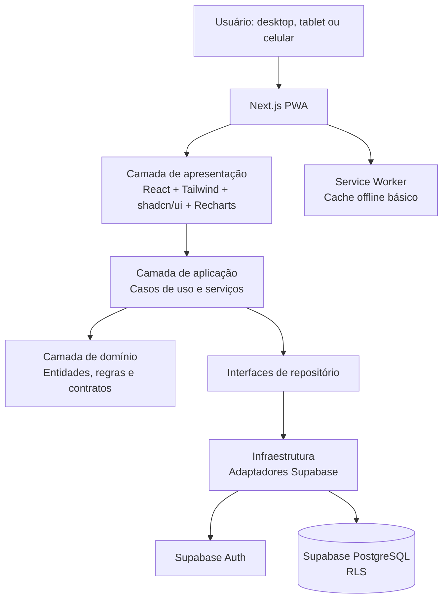
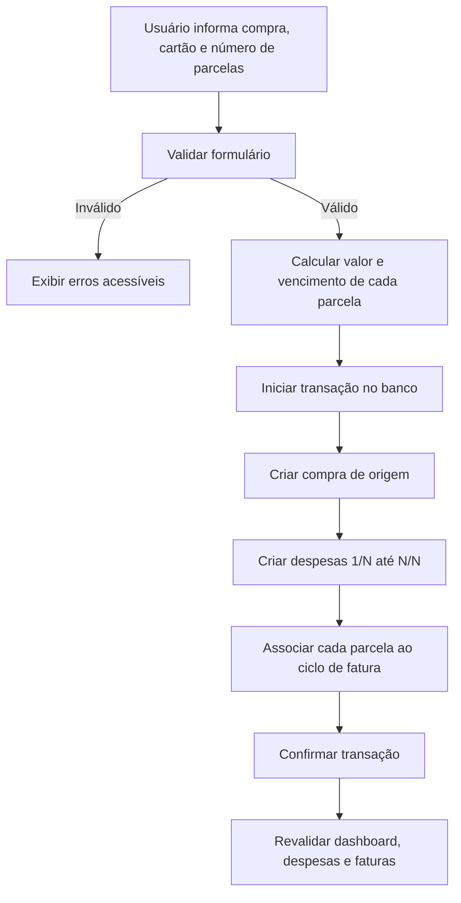
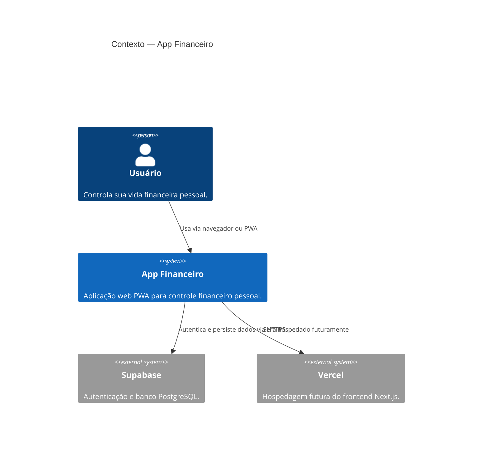
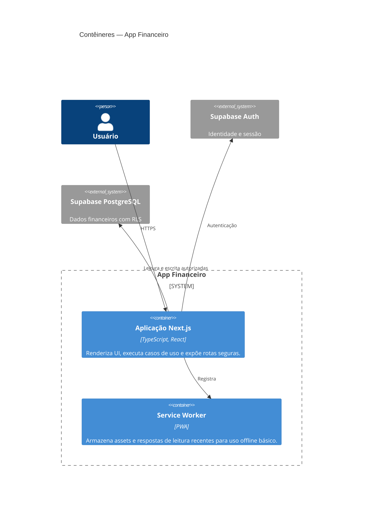
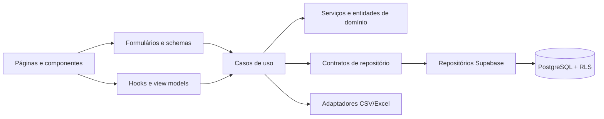

# Etapa 1 — Descoberta e Arquitetura

> **Status:** concluída (documentação). Nenhuma dependência foi instalada, nenhum serviço externo foi acessado e nenhum recurso foi criado.

## 1. Visão geral

O **App Financeiro** será uma aplicação web responsiva, instalável como PWA, para gestão financeira pessoal. Ela permitirá que cada usuário controle despesas avulsas, cartões de crédito, compras parceladas, assinaturas, contas fixas e objetivos financeiros.

O produto será construído com **Next.js + React + TypeScript** no cliente e **Supabase** como plataforma de autenticação e PostgreSQL. A publicação futura será realizada manualmente pelo responsável do projeto via Vercel.

### Premissas de produto

- Cada conta possui um controle financeiro pessoal e pode participar de controles compartilhados. Dados são isolados por controle financeiro (`workspace_id`).
- Valores monetários são armazenados em centavos no banco para evitar erros de precisão decimal.
- Datas financeiras são tratadas como datas de calendário, sem horário, quando não houver necessidade de timestamp.
- Lançamentos recorrentes e parcelas serão materializados no banco para que faturas e relatórios permaneçam rápidos, auditáveis e consistentes.
- A primeira versão considera uma moeda principal por usuário, com padrão `BRL`; suporte a múltiplas moedas não faz parte do escopo inicial.
- O saldo atual será calculado a partir de receitas e despesas efetivadas. Como o escopo atual detalha despesas, será incluído o conceito mínimo de lançamentos de receita na modelagem para que o KPI de saldo tenha significado funcional.

### Personas principais

| Persona | Necessidade principal |
| --- | --- |
| Pessoa que usa cartão de crédito | Acompanhar limite, fechamento, vencimento e parcelas futuras. |
| Pessoa com despesas recorrentes | Antecipar assinaturas e contas fixas para evitar esquecimentos. |
| Pessoa orientada a metas | Acompanhar reserva, viagem ou investimento contra uma meta financeira. |

## 2. Escopo funcional

### 2.1 Casos de uso

| Código | Caso de uso | Ator | Resultado esperado |
| --- | --- | --- | --- |
| UC-01 | Criar conta e iniciar sessão | Visitante | Usuário autenticado com área privada disponível. |
| UC-02 | Recuperar acesso | Visitante | Usuário recebe fluxo seguro de redefinição de senha. |
| UC-03 | Gerenciar categorias | Usuário autenticado | Categorias pessoais disponíveis para classificar despesas. |
| UC-04 | Registrar despesa à vista | Usuário autenticado | Despesa classificada e refletida nos indicadores. |
| UC-05 | Editar ou excluir despesa | Usuário autenticado | Dados e totais derivados são atualizados com consistência. |
| UC-06 | Gerenciar cartões | Usuário autenticado | Cartões com ciclo de fechamento, vencimento e limite cadastrados. |
| UC-07 | Registrar compra parcelada | Usuário autenticado | Todas as parcelas são geradas, vinculadas ao cartão e distribuídas nas faturas corretas. |
| UC-08 | Consultar faturas | Usuário autenticado | Fatura atual, próxima e futuras exibem gastos confirmados e previstos. |
| UC-09 | Gerenciar assinaturas | Usuário autenticado | Cobranças recorrentes futuras são previstas e vinculadas a cartões quando aplicável. |
| UC-10 | Gerenciar contas fixas | Usuário autenticado | Lançamentos futuros respeitam a frequência configurada. |
| UC-11 | Gerenciar objetivos | Usuário autenticado | Progresso, valor restante e percentual concluído são calculados. |
| UC-12 | Consultar dashboard | Usuário autenticado | KPIs, gráficos e filtros consolidados são exibidos. |
| UC-13 | Emitir relatórios | Usuário autenticado | Relatórios filtrados podem ser exportados em CSV e Excel. |
| UC-14 | Usar aplicação offline básica | Usuário autenticado | Interface e dados em cache recentes continuam acessíveis; mutações aguardam conexão ou informam indisponibilidade. |
| UC-15 | Compartilhar controle financeiro | Proprietário | Adiciona uma pessoa existente como editor ou visualizador. |
| UC-16 | Alternar controle ativo | Participante | Visualiza somente os dados do controle financeiro escolhido. |

### 2.2 Requisitos funcionais

| Área | Requisitos |
| --- | --- |
| Autenticação | Cadastro, login, logout, recuperação de senha, proteção de rotas e persistência de sessão via Supabase Auth. |
| Categorias | Criar, listar, editar e excluir categorias; impedir exclusão de categorias já referenciadas sem uma ação explícita de reclassificação. |
| Despesas | Criar, visualizar, editar e excluir despesas com descrição, valor, data, categoria, forma de pagamento e observações. |
| Cartões | Manter nome, banco, bandeira, limite, dia de fechamento, dia de vencimento e cor identificadora. |
| Parcelamentos | Criar N parcelas a partir de uma compra; preservar vínculo de origem, número e total de parcelas; atribuir cada parcela à fatura adequada. |
| Faturas | Exibir totais utilizado, previsto, parcelado, assinaturas e itens por ciclo de cartão. |
| Assinaturas | Manter valor, cartão opcional, frequência e dia de cobrança; projetar lançamentos futuros. |
| Contas fixas | Manter descrição, valor, categoria, frequência e próxima cobrança; projetar lançamentos futuros. |
| Objetivos | Manter nome, meta e valor atual; calcular percentual e saldo necessário. |
| Dashboard | Exibir saldo, despesas mensais/futuras, distribuição por categoria/cartão, evolução mensal e objetivos. |
| Relatórios | Filtrar por período, categoria, cartão, assinatura e conta fixa; exportar CSV e Excel. |
| Preferências | Alternar tema claro/escuro e persistir a preferência localmente. |
| Compartilhamento | Selecionar controle ativo e administrar participantes por papel: proprietário, editor e visualizador. |

### 2.3 Requisitos não funcionais

| Categoria | Requisito |
| --- | --- |
| Responsividade | Layout mobile-first adaptado a celular, tablet e desktop. |
| Acessibilidade | Componentes navegáveis por teclado, rótulos semânticos, contraste adequado e feedback de erro acessível. |
| Segurança | Supabase Auth, RLS em todas as tabelas privadas, validação no cliente e banco, segredos somente em variáveis de ambiente. |
| Privacidade | Dados financeiros isolados por `workspace_id` e vínculo de participante; nenhuma informação sensível é registrada em logs de cliente. |
| Desempenho | Paginação em listas; agregações filtradas por período; índices compostos em chaves de filtro frequente. |
| Confiabilidade | Operações financeiras devem ser transacionais; criação de parcelas e recorrências precisa ser idempotente. |
| Offline | Cache de assets e páginas essenciais; cache de leitura recente; operações de escrita devem informar estado pendente ou indisponível. |
| Observabilidade | Erros apresentados ao usuário de forma clara e registrados posteriormente em mecanismo configurável, sem vazar dados financeiros. |
| Manutenibilidade | TypeScript estrito, lint, formatação, testes por camada e estrutura baseada em funcionalidades. |
| Compatibilidade | Versões recentes de Chrome, Edge, Firefox e Safari mobile. |

## 3. Decisões arquiteturais

### 3.1 Arquitetura escolhida

Será utilizada uma arquitetura em camadas, organizada por funcionalidade:

1. **Apresentação:** páginas e componentes React, formulários, tabelas, gráficos e estados de interface.
2. **Aplicação:** casos de uso que orquestram regras, validação e comunicação com repositórios.
3. **Domínio:** entidades, regras de negócio, contratos e tipos independentes de framework.
4. **Infraestrutura:** implementações Supabase, adaptadores de exportação, cache e mapeamento de dados.

Essa decisão aplica Clean Architecture sem criar abstrações excessivas: componentes de UI não executam consultas diretamente, e a lógica financeira não depende de React ou Supabase.

### 3.2 SOLID e padrões

- **Responsabilidade única:** cada caso de uso trata uma ação de negócio, como `CreateInstallmentPurchase`.
- **Inversão de dependência:** casos de uso dependem de interfaces de repositório; adaptadores Supabase implementam essas interfaces.
- **Repository Pattern:** centraliza persistência e consultas por agregado (`ExpenseRepository`, `CreditCardRepository`).
- **Service Layer:** serviços de domínio calculam ciclos de fatura, cronograma de parcelas e recorrências.
- **DTOs e schemas:** entradas de formulário são validadas com schemas antes de chegar aos casos de uso.
- **Result/Error padrão:** falhas previsíveis retornam erros tipados, convertidos em feedback consistente na interface.

### 3.3 Estratégia de dados financeiros

- Valores serão persistidos como inteiro em centavos, por exemplo, `R$ 12,34` = `1234`.
- Uma compra parcelada cria uma entidade de compra de origem e N despesas-filhas imutavelmente identificadas por parcela.
- Alterar uma compra parcelada será uma operação explícita: itens futuros podem ser recalculados; parcelas já liquidadas exigirão confirmação para preservar histórico.
- Recorrências mantêm uma regra de origem e lançamentos gerados. A geração deverá ser idempotente por regra, competência e usuário.
- O cálculo de fatura deve respeitar o dia de fechamento, incluindo despesas no ciclo correto mesmo quando a compra ocorre próxima ao fechamento.

### 3.4 Estratégia de estado e acesso a dados

- Dados remotos serão carregados por Server Components, Route Handlers ou Server Actions quando apropriado, mantendo credenciais restritas ao servidor.
- Componentes interativos usarão Client Components apenas quando necessário.
- Cache de servidor será revalidado após mutações; estado de formulário permanece local.
- O cache offline será introduzido posteriormente no PWA e não será tratado como fonte de verdade para cálculos financeiros.

## 4. Arquitetura da solução



### Fluxo principal: compra parcelada



## 5. Modelo C4 simplificado

### Nível 1 — Contexto



### Nível 2 — Contêineres



### Nível 3 — Componentes da aplicação



## 6. Estrutura de pastas proposta

```text
app-financeiro/
├── docs/
│   └── ETAPA_01_DESCOBERTA_E_ARQUITETURA.md
├── public/
│   ├── icons/                         # Ícones PWA (etapa 8)
│   └── manifest.webmanifest            # Manifest (etapa 8)
├── src/
│   ├── app/
│   │   ├── (auth)/                     # Login, cadastro e recuperação
│   │   ├── (dashboard)/                # Rotas autenticadas
│   │   │   ├── dashboard/
│   │   │   ├── expenses/
│   │   │   ├── categories/
│   │   │   ├── cards/
│   │   │   ├── subscriptions/
│   │   │   ├── fixed-expenses/
│   │   │   ├── goals/
│   │   │   └── reports/
│   │   ├── api/                        # Route Handlers estritamente necessários
│   │   ├── layout.tsx
│   │   └── page.tsx
│   ├── components/
│   │   ├── ui/                         # Componentes gerados/adaptados do shadcn/ui
│   │   ├── charts/                     # Componentes Recharts reutilizáveis
│   │   └── layout/                     # Navegação, cabeçalho e estrutura visual
│   ├── features/
│   │   ├── auth/
│   │   ├── categories/
│   │   ├── expenses/
│   │   ├── credit-cards/
│   │   ├── invoices/
│   │   ├── subscriptions/
│   │   ├── fixed-expenses/
│   │   ├── financial-goals/
│   │   ├── dashboard/
│   │   └── reports/
│   │       ├── domain/                 # Entidades, contratos e regras
│   │       ├── application/            # Casos de uso, DTOs e schemas
│   │       ├── infrastructure/         # Repositórios e mapeadores Supabase
│   │       └── presentation/           # Componentes e hooks específicos
│   ├── lib/
│   │   ├── supabase/                   # Clientes browser/server e middleware
│   │   ├── validations/                # Primitivos de validação compartilhados
│   │   ├── formatters/                 # Moeda, data e número
│   │   └── utils/
│   ├── types/                          # Tipos transversais e tipos gerados do banco
│   └── styles/
│       └── globals.css
├── supabase/
│   ├── migrations/                     # Scripts SQL versionados (etapa 2)
│   └── seed.sql                        # Dados demonstrativos opcionais e não produtivos
├── tests/
│   ├── unit/
│   ├── integration/
│   └── e2e/
├── .env.example
├── next.config.ts
├── package.json
├── tailwind.config.ts
└── tsconfig.json
```

> A estrutura será criada apenas na Etapa 3. A organização por `features` evita acoplamento entre domínios, enquanto `components` e `lib` concentram itens realmente compartilhados.

## 7. Diretrizes de UX

- **Mobile-first:** navegação inferior em telas pequenas e barra lateral recolhível no desktop.
- **Entrada rápida:** formulário de despesa com os campos essenciais primeiro; observações como campo opcional.
- **Feedback imediato:** máscaras de moeda, prévia de parcelas, validação por campo e confirmações antes de exclusões destrutivas.
- **Visibilidade financeira:** cartões de KPI no topo, cores com significado não exclusivo e tendência mensal em gráficos.
- **Acessibilidade:** não depender apenas de cor para status, foco visível, áreas de toque adequadas e textos alternativos para gráficos.
- **Tema:** claro e escuro por tokens de design, respeitando preferência do sistema na primeira visita.

## 8. Roadmap das próximas etapas

| Etapa | Entrega | Dependências |
| --- | --- | --- |
| 2 | Modelo relacional, DER, dicionário, SQL, índices, constraints e RLS. | Arquitetura desta etapa aprovada. |
| 3 | Estrutura Next.js, TypeScript, Tailwind, ESLint, Prettier e dependências documentadas. | Modelo técnico e convenções definidos. |
| 4 | Fluxo de autenticação e proteção de rotas. | Projeto base e configuração manual do Supabase. |
| 5 | Módulos financeiros, progressivamente: categorias, despesas, cartões, parcelamentos, assinaturas, contas fixas e objetivos. | Banco e autenticação concluídos. |
| 6 | Dashboard, KPIs, filtros e gráficos. | Módulos financeiros disponíveis. |
| 7 | Relatórios e exportação CSV/Excel. | Dados financeiros e filtros definidos. |
| 8 | Manifest, service worker, ícones e experiência de instalação PWA. | Aplicação funcional. |
| 9 | Guia manual de GitHub, Supabase e Vercel. | Projeto validado localmente pelo responsável. |

## 9. Critérios de aceite da Etapa 1

- [x] Escopo e premissas registrados.
- [x] Casos de uso e requisitos funcionais definidos.
- [x] Requisitos não funcionais definidos.
- [x] Arquitetura, fluxos e modelo C4 simplificado apresentados.
- [x] Estrutura de pastas proposta.
- [x] Roadmap e dependências das próximas etapas definidos.
- [x] Nenhuma instalação, execução ou configuração externa realizada.