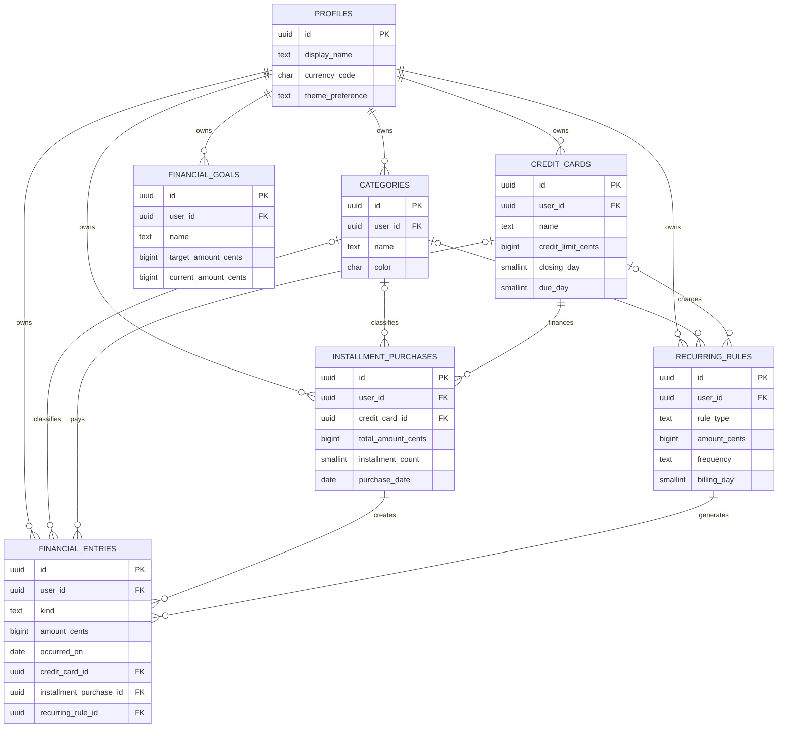

# Etapa 2 — Banco de Dados

> **Status:** concluída (documentação e script manual). Nenhum projeto Supabase foi criado, nenhum script foi executado e nenhum serviço externo foi acessado.

## 1. Decisões de modelagem

1. **Valores em centavos:** todos os valores usam `bigint` com sufixo `_cents`. Isso elimina erro de ponto flutuante em cálculos financeiros.
2. **Um lançamento central:** `financial_entries` reúne despesas, receitas, parcelas e lançamentos gerados por recorrência. Assim, dashboard e relatórios consultam uma única origem consistente.
3. **Origem preservada:** compras parceladas vivem em `installment_purchases`; cada parcela é um lançamento ligado à compra. Regras recorrentes vivem em `recurring_rules`; cada geração também mantém o vínculo de origem.
4. **Fatura derivada:** não há uma tabela de faturas gravada inicialmente. A view `credit_card_invoice_items` calcula a competência pelo fechamento e vencimento de cada cartão. Isso evita divergência entre uma despesa e sua fatura.
5. **Isolamento por controle:** toda entidade financeira possui `workspace_id`. RLS permite acesso somente a membros do controle e limita alterações a proprietários e editores.
6. **Integridade:** `check constraints`, unicidade, chaves estrangeiras e índices protegem consistência e desempenho no próprio banco.

## 2. Modelo relacional

## 3. Dicionário de dados

| Tabela | Finalidade | Campos principais |
| --- | --- | --- |
| `profiles` | Preferências do usuário autenticado. | `id`, `display_name`, `currency_code`, `theme_preference`. |
| `financial_workspaces` | Controle financeiro pessoal ou compartilhado. | `id`, `name`, `owner_profile_id`, `currency_code`. |
| `workspace_members` | Participantes e papel dentro do controle. | `workspace_id`, `profile_id`, `role`. |
| `categories` | Classificação pessoal de despesas. | `user_id`, `name`, `color`, `icon`. |
| `credit_cards` | Dados de cartão e ciclo de cobrança. | `bank_name`, `brand`, `credit_limit_cents`, `closing_day`, `due_day`, `color`. |
| `installment_purchases` | Compra original que originou parcelas. | `credit_card_id`, `category_id`, `total_amount_cents`, `installment_count`, `purchase_date`. |
| `recurring_rules` | Regra de assinatura ou conta fixa. | `rule_type`, `amount_cents`, `frequency`, `billing_day`, `generate_until`, `is_active`. |
| `financial_entries` | Movimentação individual: despesa, receita, parcela ou recorrência. | `kind`, `amount_cents`, `occurred_on`, `payment_method`, `status`, vínculos de origem. |
| `financial_goals` | Objetivo e progresso financeiro. | `name`, `target_amount_cents`, `current_amount_cents`, `target_date`. |
| `credit_card_invoice_items` | View de consulta das faturas calculadas. | `credit_card_id`, `amount_cents`, `due_date`, dados de parcela. |

### Domínios controlados

| Tipo | Valores |
| --- | --- |
| `entry_kind` | `expense`, `income` |
| `payment_method` | `cash`, `debit_card`, `credit_card`, `pix`, `bank_transfer`, `boleto`, `other` |
| `entry_status` | `pending`, `paid`, `cancelled` |
| `recurrence_frequency` | `monthly`, `quarterly`, `semiannual`, `annual` |
| `recurring_rule_type` | `subscription`, `fixed_expense` |

## 4. Integridade, índices e RLS

### Constraints relevantes

- Valores de lançamentos, regras e metas não podem ser negativos; despesas e receitas devem ser maiores que zero.
- Dias de fechamento, vencimento e cobrança devem estar entre 1 e 31.
- Uma parcela exige origem, número entre `1` e `installment_count`, e unicidade por compra/número.
- Uma ocorrência de recorrência é única por regra e data, tornando a geração idempotente.
- Cartão é obrigatório quando o método for `credit_card`; é proibido nos demais métodos.
- As regras de recorrência não podem ter fim anterior ao início, nem gerar antes do início.

### Índices relevantes

- `financial_entries (user_id, occurred_on desc)`: lista financeira, dashboard e relatórios por período.
- `financial_entries (credit_card_id, occurred_on desc)`: itens de fatura.
- `financial_entries (category_id, occurred_on desc)`: relatórios por categoria.
- Índices parciais para lançamentos pendentes, cartões ativos, regras ativas e metas não arquivadas.

### Políticas RLS

- Cada tabela privada recebe RLS habilitada.
- Leitura exige vínculo em `workspace_members`; escrita exige papel proprietário ou editor.
- A migração incremental `shared_financial_workspaces.sql` atualiza o modelo original para o compartilhamento.
- A view de fatura utiliza `security_invoker = true`; portanto, respeita as permissões do usuário que a consulta.

## 5. Script SQL entregue

Arquivo criado:

- `supabase/migrations/descricao_consulta.sql`
- `supabase/migrations/shared_financial_workspaces.sql`

Ele contém, de forma completa:

- tipos enumerados;
- tabelas e relacionamentos;
- constraints;
- índices;
- gatilhos de `updated_at`;
- criação automática de perfil após cadastro no Auth;
- função de cálculo da data de vencimento da fatura;
- view de itens de fatura;
- RLS e políticas de acesso.
- Migração incremental para controles compartilhados, participantes e permissões.

## 6. Configuração manual no Supabase — não executada

Quando chegar a Etapa 4 ou quando for solicitado configurar o banco, faça manualmente:

1. Acesse [Supabase](https://supabase.com/) e entre na sua conta.
2. Clique em **New project**.
3. Escolha sua organização, defina o nome do projeto, uma senha forte para o banco e a região desejada.
4. Aguarde o provisionamento do projeto terminar.
5. No menu lateral, abra **SQL Editor**.
6. Clique em **New query**.
7. Abra localmente o arquivo `supabase/migrations/descricao_consulta.sql`.
8. Copie todo o conteúdo do arquivo, cole no editor SQL e clique em **Run**.
9. Em uma nova consulta, execute todo o conteúdo de `supabase/migrations/shared_financial_workspaces.sql`.
10. Confirme no menu **Table Editor** que as tabelas foram criadas, incluindo `financial_workspaces` e `workspace_members`.
11. Em **Authentication > Providers**, mantenha **Email** habilitado para a Etapa 4. Não altere provedores adicionais sem uma necessidade definida.

### Verificação manual recomendada

Após executar o script no Supabase, confira:

1. Em **Database > Tables**, existem as sete tabelas públicas e a view de fatura.
2. Em cada tabela, a aba ou seção de políticas indica que RLS está ativado.
3. Em **Authentication > Users**, crie um usuário de teste somente quando a Etapa 4 estiver em execução; o gatilho criará o respectivo perfil.

> Não armazene a `service_role key` no frontend. Na Etapa 3 será criado somente um arquivo `.env.example`, sem chaves reais.

## 7. Pendências e dependências

### Entregue nesta etapa

- Modelo relacional e DER.
- Dicionário de dados.
- Script SQL completo com constraints, índices, funções, view, gatilhos e RLS.
- Instruções manuais para executar o script no Supabase.

### Ainda falta

- Criar a estrutura do projeto Next.js e suas configurações.
- Executar manualmente o SQL em um projeto Supabase que o responsável criar.
- Implementar autenticação e as funcionalidades do produto.

### Próxima etapa

**Etapa 3 — Estrutura do Projeto:** serão definidos diretórios, configurações Next.js, TypeScript, Tailwind, ESLint e Prettier. Nenhuma dependência será instalada; serão apresentados apenas os comandos manuais necessários.

### Complemento: controles compartilhados

Depois de aplicar o script base, aplique `supabase/migrations/shared_financial_workspaces.sql`. O guia `docs/COMPARTILHAMENTO_DE_CONTROLE_FINANCEIRO.md` descreve o modelo, as permissões e o teste manual de compartilhamento.