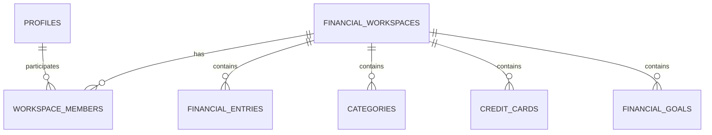

# Controles Financeiros Compartilhados

## Objetivo

Um controle financeiro pode ter várias pessoas. Cada pessoa entra com sua própria conta, escolhe o controle compartilhado e enxerga os mesmos dados daquele controle: categorias, despesas, cartões, parcelamentos, assinaturas, contas fixas, objetivos, dashboard e relatórios.

Uma pessoa também pode participar de mais de um controle, sem misturar os dados entre eles.

## Papéis

| Papel | Leitura | Alterar dados financeiros | Adicionar participantes |
| --- | --- | --- | --- |
| Proprietário | Sim | Sim | Sim |
| Editor | Sim | Sim | Não |
| Visualizador | Sim | Não | Não |

## Arquitetura

O `workspace_id` passa a ser o limite de isolamento financeiro. O usuário autenticado só pode acessar um workspace quando existe um vínculo em `workspace_members`. RLS continua sendo a autorização definitiva.

## Arquivos criados ou alterados

- `supabase/migrations/shared_financial_workspaces.sql`
- `src/features/workspaces/**`
- `src/lib/workspaces/active-workspace.ts`
- `src/app/(dashboard)/workspace/page.tsx`
- Repositórios dos módulos financeiros, dashboard e relatórios.

## Aplicação manual no Supabase

> Não execute automaticamente. Faça backup antes de alterar uma base com dados.

1. Abra **Supabase > SQL Editor**.
2. Clique em **New query**.
3. Abra `supabase/migrations/shared_financial_workspaces.sql`.
4. Copie o arquivo completo para a consulta.
5. Clique em **Run** apenas uma vez.
6. Confirme que as tabelas `financial_workspaces` e `workspace_members` foram criadas.
7. Confirme que cada usuário existente recebeu um workspace pessoal e vínculo `owner`.
8. Confirme que as tabelas financeiras possuem `workspace_id` e que as políticas RLS foram atualizadas.

Para um projeto criado do zero, aplique primeiro `descricao_consulta.sql` e em seguida `shared_financial_workspaces.sql`.

## Como compartilhar

1. A pessoa convidada deve criar e confirmar sua conta antes de ser adicionada.
2. O proprietário abre `/workspace`.
3. Em **Participantes**, informa o e-mail da pessoa e escolhe **Editor** ou **Visualizador**.
4. A pessoa adicionada entra com a própria conta.
5. Ela seleciona o controle na lista de **Controle ativo**.
6. A partir desse momento, os módulos mostram somente os dados do controle escolhido.

## Limitações da primeira versão

- A adição é direta e exige que a conta do participante já exista; não há envio automático de convite por e-mail.
- Remoção de participante, transferência de propriedade e criação de novos controles pela interface são evoluções futuras.
- Não compartilhe uma conta de usuário: cada participante deve usar seu próprio login.

## Teste manual sugerido

1. Crie duas contas confirmadas no Supabase Auth.
2. Entre com a primeira e crie uma categoria e uma despesa no controle pessoal.
3. Abra `/workspace` e adicione a segunda conta como editor.
4. Entre com a segunda conta, selecione o controle compartilhado e confirme que a categoria e a despesa aparecem.
5. Como editor, crie uma nova despesa e confirme que a primeira conta a visualiza.
6. Altere o papel para visualizador diretamente no Supabase apenas para teste e confirme que ele consegue ler, mas não gravar.