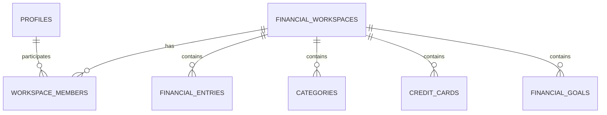

# Controles Financeiros Compartilhados

## Objetivo

Um controle financeiro pode ter várias pessoas. Cada pessoa entra com sua própria conta, escolhe o controle compartilhado e enxerga os mesmos dados daquele controle: lançamentos, cartões, compras parceladas, assinaturas, contas fixas, objetivos, dashboard e relatórios.

Uma pessoa também pode participar de mais de um controle, sem misturar os dados entre eles.

Uma conta recém-criada recebe somente o perfil: nenhum controle financeiro é criado automaticamente. A pessoa pode criar o primeiro controle na tela **Compartilhar** ou aguardar que um proprietário a adicione a um controle existente.

## Papéis

| Papel | Leitura | Alterar dados financeiros | Administrar participantes e controle |
| --- | --- | --- | --- |
| Proprietário | Sim | Sim | Sim |
| Editor | Sim | Sim | Não |
| Visualizador | Sim | Não | Não |

## Arquitetura

O `workspace_id` passa a ser o limite de isolamento financeiro. O usuário autenticado só pode acessar um workspace quando existe um vínculo em `workspace_members`. RLS continua sendo a autorização definitiva.

## Arquivos criados ou alterados

- `supabase/migrations/shared_financial_workspaces.sql`
- `supabase/migrations/workspace_settings_management.sql`
- `src/features/workspaces/**`
- `src/lib/workspaces/active-workspace.ts`
- `src/app/(dashboard)/workspace/page.tsx`
- Repositórios dos módulos financeiros, dashboard e relatórios.

## Aplicação manual no Supabase

> Não execute automaticamente. Faça backup antes de alterar uma base com dados.

1. Abra **Supabase > SQL Editor**.
2. Clique em **New query**.
3. Abra `supabase/migrations/shared_financial_workspaces.sql`.
4. Copie o arquivo completo para a consulta.
5. Clique em **Run** apenas uma vez.
6. Confirme que as tabelas `financial_workspaces` e `workspace_members` foram criadas.
7. Confirme que cada usuário existente recebeu um workspace pessoal e vínculo `owner`.
8. Confirme que as tabelas financeiras possuem `workspace_id` e que as políticas RLS foram atualizadas.
9. Depois, abra `workspace_settings_management.sql`, copie seu conteúdo completo e execute-o uma única vez.
10. Confirme que as funções `create_financial_workspace`, `update_workspace_member_role`, `remove_workspace_member`, `transfer_workspace_ownership` e `delete_financial_workspace` estão disponíveis.
11. Confirme que a função `handle_new_user` cria apenas a linha em `profiles`, sem inserir `financial_workspaces` ou `workspace_members`.

Para um projeto criado do zero, aplique nesta ordem: `descricao_consulta.sql`, `shared_financial_workspaces.sql` e `workspace_settings_management.sql`.

## Como compartilhar

1. A pessoa convidada deve criar e confirmar sua conta antes de ser adicionada.
2. O proprietário abre **Compartilhar** (`/workspace`).
3. Para criar um controle separado, informa o nome em **Novo controle financeiro**. O novo controle é selecionado automaticamente.
4. Em **Participantes**, informa o e-mail da pessoa e escolhe **Editor** ou **Visualizador**.
5. A pessoa adicionada entra com a própria conta e seleciona o controle desejado.
6. O proprietário pode alterar a permissão, remover a pessoa ou transferir a propriedade para um participante existente.
7. A partir desse momento, os módulos mostram somente os dados do controle escolhido.

O seletor de controle ativo também fica disponível no topo das páginas autenticadas. Assim, a pessoa pode alternar rapidamente entre controles aos quais tem acesso sem retornar à tela de compartilhamento.

## Ciclo de vida de controles

- Um usuário pode criar vários controles financeiros próprios.
- Apenas o proprietário pode excluir um controle; a exclusão apaga seus dados e participantes por cascata.
- A interface exige que a conta mantenha ou crie outro controle acessível antes de apagar o último controle selecionado.
- Antes de excluir uma conta proprietária de controle compartilhado, transfira a propriedade ou exclua o controle. Essa proteção também é validada pelo banco.

## Configurações da conta

Em **Configurações** (`/settings`) o usuário pode atualizar o nome de perfil, escolher o tema claro/escuro/sistema e solicitar a exclusão definitiva da conta.

A exclusão da conta usa a rota protegida `/api/account` e exige `SUPABASE_SERVICE_ROLE_KEY` disponível somente no ambiente de servidor. A variável nunca deve receber o prefixo `NEXT_PUBLIC_`.

## Limitações atuais

- A adição é direta e exige que a conta do participante já exista; não há envio automático de convite por e-mail.
- Não compartilhe uma conta de usuário: cada participante deve usar seu próprio login.

## Teste manual sugerido

1. Crie duas contas confirmadas no Supabase Auth.
2. Entre com a primeira e crie uma categoria e uma despesa no controle pessoal.
3. Abra `/workspace` e adicione a segunda conta como editor.
4. Entre com a segunda conta, selecione o controle compartilhado e confirme que a categoria e a despesa aparecem.
5. Como editor, crie uma nova despesa e confirme que a primeira conta a visualiza.
6. Como proprietário, altere a segunda conta para visualizador e confirme que ela consegue ler, mas não gravar.
7. Altere novamente para editor, transfira a propriedade e confirme que o antigo proprietário perde os controles administrativos.
8. Crie um segundo controle e confirme que os dados não se misturam.