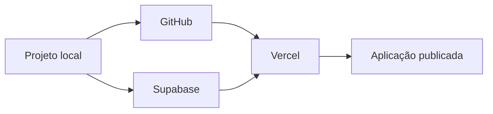

# Etapa 10 — Deploy Manual

> **Status:** guia concluído. Nenhum comando foi executado, nenhum repositório foi criado e nenhum serviço externo foi acessado.

## 1. Visão geral do fluxo



Ordem recomendada:

1. Preparar e validar o projeto local.
2. Criar e configurar o projeto Supabase.
3. Criar o repositório GitHub e enviar o código.
4. Importar o repositório na Vercel e configurar variáveis.
5. Validar autenticação, PWA e recursos financeiros em produção.

## 2. Pré-requisitos locais

Antes de publicar, confira manualmente:

- Node.js LTS instalado, preferencialmente versão 22 ou superior.
- Uma conta no GitHub.
- Uma conta no Supabase.
- Uma conta na Vercel, podendo ser criada com GitHub.
- Dependências instaladas localmente.
- Arquivo `.env.local` preenchido apenas no seu computador.

Na raiz do projeto, execute manualmente os comandos abaixo, um por vez:

```powershell
npm install
npm run typecheck
npm run lint
npm run format:check
npm run build
```

Corrija qualquer falha antes de continuar. Esses comandos não foram executados durante este projeto.

> O `npm install` instalará a dependência `xlsx`, adicionada na Etapa 7 para exportação Excel.

## 3. Supabase

### 3.1 Criar projeto

1. Acesse [Supabase](https://supabase.com/) e faça login.
2. Clique em **New project**.
3. Selecione sua organização.
4. Informe um nome, por exemplo `app-financeiro`.
5. Defina uma senha forte para o banco e guarde-a em um gerenciador de senhas.
6. Escolha a região mais próxima dos usuários.
7. Escolha um plano compatível com seu uso. Comece pelo plano gratuito se ele atender às limitações atuais.
8. Clique em **Create new project** e aguarde o provisionamento.

### 3.2 Criar banco e políticas

1. No menu lateral, acesse **SQL Editor**.
2. Clique em **New query**.
3. Abra o arquivo local `supabase/migrations/descricao_consulta.sql`.
4. Para um projeto novo, copie **todo** o conteúdo do arquivo e cole no editor.
5. Clique em **Run**.
6. Em seguida, aplique `supabase/migrations/shared_financial_workspaces.sql` para habilitar controles compartilhados.
7. Por fim, aplique `supabase/migrations/workspace_settings_management.sql` para habilitar múltiplos controles, administração de participantes e exclusão segura.
8. Aplique `supabase/migrations/bank_accounts_and_salary.sql` para habilitar bancos, contas, cartões vinculados e salário mensal planejado.
9. Aplique `supabase/migrations/20261021_financial_integrity.sql` para ativar validações de integridade entre controles financeiros e a proteção da exclusão do último controle acessível.
10. Consulte `docs/ETAPA_06_CONTROLE_COMPARTILHADO.md` para validar os papéis e o fluxo de participantes.
11. Abra **Table Editor** e confirme as tabelas:
   - `profiles`
   - `categories`
   - `credit_cards`
   - `installment_purchases`
   - `recurring_rules`
   - `financial_entries`
   - `financial_goals`
   - `bank_accounts`
12. Confirme também a view `credit_card_invoice_items`, as funções de parcelamento/recorrência e as funções de gerenciamento de controles.

> Para banco que já recebeu scripts parciais durante o desenvolvimento, não cole o arquivo todo novamente: execute somente os blocos de função ainda não aplicados, conforme os documentos dos módulos. Para a produção final, a abordagem recomendada é criar um projeto novo e aplicar o script completo uma única vez.

### 3.3 Configurar autenticação

1. Abra **Authentication > Providers**.
2. Confirme que **Email** está habilitado.
3. Mantenha **Confirm email** habilitado em produção.
4. Abra **Authentication > URL Configuration**.
5. Em **Site URL**, informe a URL de produção da Vercel após o primeiro deploy, por exemplo `https://app-financeiro.vercel.app`.
6. Em **Redirect URLs**, inclua:
   - `http://localhost:3000/auth/callback`
   - `https://SEU-PROJETO.vercel.app/auth/callback`
7. Caso use domínio próprio, adicione também:
   - `https://SEU-DOMINIO/auth/callback`
8. Clique em **Save**.

### 3.4 Obter variáveis públicas

1. Acesse **Project Settings > API**.
2. Copie **Project URL**.
3. Copie a chave pública identificada como **Publishable key**.
4. Copie a **service_role key** somente se desejar habilitar a exclusão definitiva de conta. Ela será cadastrada exclusivamente como segredo de servidor na Vercel.
5. Nunca use a `service_role key` no frontend, em código do navegador ou em arquivos versionados.

Esses valores serão usados na Vercel e localmente:

```text
NEXT_PUBLIC_SUPABASE_URL=https://SEU_PROJECT_REF.supabase.co
NEXT_PUBLIC_SUPABASE_PUBLISHABLE_KEY=SUA_CHAVE_PUBLICA
```

## 4. GitHub

### 4.1 Criar repositório remoto

1. Acesse [GitHub](https://github.com/) e entre na sua conta.
2. Clique no ícone **+** no canto superior direito e escolha **New repository**.
3. Informe um nome, por exemplo `app-financeiro`.
4. Escolha a visibilidade desejada. Para código financeiro pessoal, considere **Private**.
5. Não marque a criação de README, `.gitignore` ou licença, pois o projeto já possui arquivos locais.
6. Clique em **Create repository**.
7. Copie a URL HTTPS exibida pelo GitHub.

### 4.2 Inicializar Git e enviar o código

No PowerShell, na pasta raiz `App_Financeiro`, substitua `URL_DO_REPOSITORIO` pela URL HTTPS copiada:

```powershell
git init
git add .
git commit -m "feat: criar sistema de controle financeiro pessoal"
git branch -M main
git remote add origin URL_DO_REPOSITORIO
git push -u origin main
```

### 4.3 Conferir arquivos antes do commit

Não envie estes itens ao GitHub:

- `.env.local`
- `node_modules/`
- `.next/`
- chaves privadas
- `service_role key` do Supabase

O arquivo `.gitignore` criado na Etapa 3 já cobre os principais casos. Antes de rodar `git add .`, abra `.gitignore` e confirme que `.env.local` está presente.

### 4.4 Fluxo de atualizações

Para cada alteração futura, revise, valide e envie manualmente:

```powershell
git status
git add .
git commit -m "tipo: descrição objetiva da alteração"
git push
```

Exemplos de prefixos: `feat`, `fix`, `docs`, `refactor`, `chore`.

## 5. Vercel

### 5.1 Importar projeto

1. Acesse [Vercel](https://vercel.com/) e faça login.
2. Clique em **Add New > Project**.
3. Se necessário, conecte sua conta GitHub e autorize o acesso ao repositório `app-financeiro`.
4. Na lista **Import Git Repository**, localize o repositório e clique em **Import**.
5. Confirme que o framework detectado é **Next.js**.
6. Mantenha o diretório raiz como `./`, pois o `package.json` fica na raiz do repositório.

### 5.2 Configurar variáveis de ambiente

Antes de clicar em Deploy, em **Environment Variables**, adicione as duas variáveis para os ambientes necessários — ao menos **Production** e **Preview**:

| Nome | Valor |
| --- | --- |
| `NEXT_PUBLIC_SUPABASE_URL` | URL do projeto Supabase. |
| `NEXT_PUBLIC_SUPABASE_PUBLISHABLE_KEY` | Chave pública/publishable do Supabase. |

Se desejar habilitar a exclusão definitiva de conta, adicione também a variável abaixo para **Production** e **Preview**. Ela é lida apenas pela rota de servidor `/api/account`:

| Nome | Valor |
| --- | --- |
| `SUPABASE_SERVICE_ROLE_KEY` | Chave secreta service role do Supabase. |

> Nunca use `NEXT_PUBLIC_SUPABASE_SERVICE_ROLE_KEY` e nunca exponha esse valor em componentes Client.

### 5.3 Publicar

1. Revise as variáveis de ambiente.
2. Clique em **Deploy**.
3. Aguarde a conclusão do build.
4. Clique em **Visit** para abrir a URL atribuída pela Vercel.
5. Copie a URL final da Vercel.
6. Volte ao Supabase e conclua a configuração de **Site URL** e **Redirect URLs** na seção 3.3.
7. Faça um novo deploy na Vercel depois de atualizar configurações ou variáveis, se necessário.

### 5.4 Deploys futuros

Após a integração, cada `git push` para `main` gera deploy de produção. Pushes em branches podem gerar URLs de preview, conforme a configuração da Vercel.

## 6. Domínio próprio — opcional

1. Na Vercel, abra o projeto e acesse **Settings > Domains**.
2. Clique em **Add** e informe seu domínio.
3. Siga as instruções da Vercel para criar os registros DNS no provedor do domínio.
4. Aguarde a validação de DNS e emissão de HTTPS.
5. Atualize o **Site URL** e adicione `https://SEU-DOMINIO/auth/callback` ao Supabase.
6. Teste cadastro, confirmação de e-mail, login e recuperação de senha novamente.

## 7. Checklist pós-publicação

- [ ] URL de produção abre com HTTPS.
- [ ] Cadastro confirma e-mail e redireciona para a aplicação.
- [ ] Login, logout e recuperação de senha funcionam.
- [ ] Rotas privadas redirecionam para login sem sessão.
- [ ] RLS impede que um usuário acesse dados de outro.
- [ ] Receitas, despesas e compras parceladas funcionam em **Lançamentos**.
- [ ] Adiantamento de parcelas com e sem desconto funciona.
- [ ] Bancos e contas permitem cadastrar contas, saldo inicial e salário mensal; cartões vinculados permitem arquivar/reativar e excluir quando seguro.
- [ ] Criação de controles, permissões, remoção de participantes e transferência de propriedade funcionam.
- [ ] Configurações de perfil/aparência funcionam; exclusão de conta é testada apenas em ambiente seguro.
- [ ] Dashboard e relatórios carregam dados corretos.
- [ ] Exportação CSV e Excel funciona.
- [ ] Manifest e instalação PWA funcionam em navegador compatível.
- [ ] Navegação offline direciona para a página offline, sem expor dados financeiros em cache.

## 8. O que foi entregue no projeto

- Etapa 1: descoberta, arquitetura, casos de uso e roadmap.
- Etapa 2: banco PostgreSQL, RLS, índices e funções SQL.
- Etapa 3: estrutura Next.js, TypeScript, Tailwind, ESLint e Prettier.
- Etapa 4: autenticação Supabase, middleware e rotas protegidas.
- Etapa 5: categorias, lançamentos, bancos/contas, cartões vinculados, parcelamentos, assinaturas, contas fixas e objetivos.
- Etapa 6: dashboard com KPIs, filtro e gráficos.
- Etapa 7: relatórios e exportação CSV/Excel.
- Etapa 8: PWA, manifest, service worker e fallback offline.
- Etapa 9: este guia manual de publicação.

## 9. Observações de segurança e operação

- Mantenha Node.js, dependências e o lockfile atualizados de forma controlada.
- Faça backup do banco periodicamente pelo painel Supabase, conforme seu plano e necessidade.
- Revise periodicamente usuários em **Authentication > Users**.
- Nunca compartilhe senha do banco, chaves secretas ou `.env.local`.
- Antes de alterar o SQL em produção, faça backup e teste em um projeto Supabase separado.